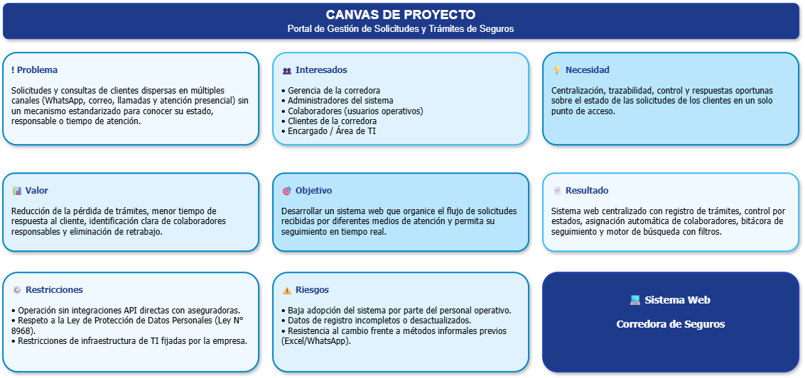
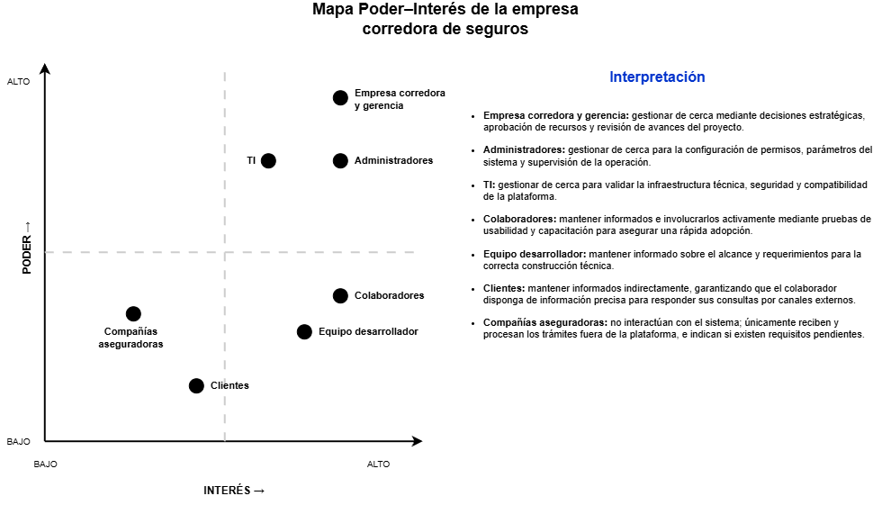
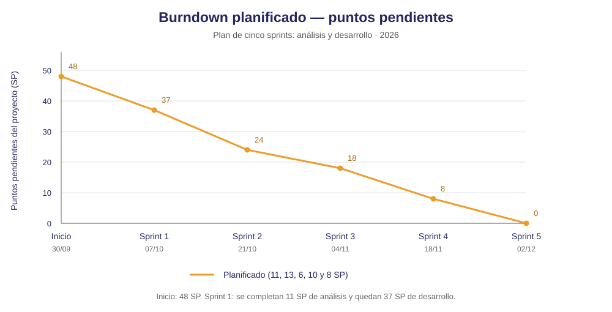

# Sistema de gestión y seguimiento de solicitudes de clientes para una empresa corredora de seguros

**Integrantes del equipo:**

- Seidy Alanis Balladares.
- Walbyn González Sequeira.

## Historial de versiones

Este historial registra los avances realizados cada semana durante el desarrollo del proyecto.

| Versión | Semana | Fecha | Avance realizado |
| --- | --- | --- | --- |
| 0.1 | 2 | 23/09/2026 | Documentación de la propuesta inicial: problema, sistema propuesto, roles, valor esperado y objetivos. |
| 0.2 | 2 | 26/09/2026 | Análisis de interesados (registro, mapa Poder–Interés e interesados críticos) y selección del Enfoque Híbrido de desarrollo.|
| 0.3 | 3 | 01/10/2026 | Definición del Scrum Team y distribución de responsabilidades de gestión, desarrollo, diseño, arquitectura y calidad. |
| 0.4 | 3 | 03/10/2026 | Incorporación acta de inicio, factores ambientales (EEFs) y diseño del Canvas del Proyecto |
| 0.5 | 4 | 10/10/2026 | Reorganización del documento basado en la guía para conformar el expediente. Además, incuye producto goal y etapas del cliclo de vida|
| 0.6 | 4 | 10/10/2026 | Planteamiento del primer spring del proyecto.|
| 0.7 | 4 | 10/10/2026 | Elaboración del backlog inicial, sprint backlog y mecanismo de seguimiento.|
| 0.8 | 5 | 18/10/2026 | Redacción del detalle de las historias de usuario, corrección del backlog y ampliación de actividades en los sprints.|
| 0.9 | 5 | 18/10/2026 | Se referencia los apartados solicitados para esta semana (alcance, product backlog y criterios de aceptación). |
| 0.10 | 6 | 22/10/2026 | Ampliación y ajuste de los criterios de aceptación dentro de cada historia de usuario, incluyendo validaciones, manejo de errores, conservación de datos, actualización del panel y restricciones de acceso por rol. Simplificación de su redacción y eliminación de la palabra «capacidad» en la planificación de los sprints. |
| 0.11 | 6 | 22/10/2026 | Elaboración del plan temporal, matriz de estimaciones, cronograma de entregas por sprint, gráfico burndown planificado y estimación de costos del proyecto. |
| 0.12 | 6 | 22/10/2026 | Incorporación de HU-03 para editar solicitudes, con validación, guardado, cancelación y conservación del seguimiento; renumeración de historias y actualización del backlog, estimaciones y cronograma. |

---

## Tabla de Contenidos

[Semana 1](#semana-1)

- [1. Acta de inicio (Project Charter)](#1-acta-de-inicio-project-charter)
  - [Planteamiento del problema](#planteamiento-del-problema)
  - [Proyecto propuesto](#proyecto-propuesto)
    - [Administrador](#administrador)
    - [Colaborador](#colaborador)
  - [Valor esperado](#valor-esperado)
  - [Objetivos](#objetivos)
    - [Objetivo general](#objetivo-general)
    - [Objetivos específicos](#objetivos-específicos)
  - [Alcance y límites generales](#alcance-y-límites-generales)
    - [Inclusiones (Dentro del Alcance)](#inclusiones-dentro-del-alcance)
    - [Exclusiones (Fuera del Alcance)](#exclusiones-fuera-del-alcance)

- [2. Product Goal](#2-product-goal)

- [3. Scrum Team](#3-scrum-team)
  - [Asignación de responsabilidades de Scrum](#asignación-de-responsabilidades-de-scrum)
  - [Distribución de funciones técnicas](#distribución-de-funciones-técnicas)

[Semana 2](#semana-2)

- [1. Contexto organizacional](#4-contexto-organizacional)
  - [Factores Ambientales de la Empresa (EEFs)](#factores-ambientales-de-la-empresa-eefs)
    - [Factores Internos](#factores-internos)
    - [Factores Externos](#factores-externos)
  - [Canvas del Proyecto](#canvas-del-proyecto)

- [2. Mapa de interesados](#5-mapa-de-interesados)
  - [Identificación de los interesados](#identificación-de-los-interesados)
  - [Registro de interesados](#registro-de-interesados)
  - [Valoración del poder y el interés](#valoración-del-poder-y-el-interés)
  - [Mapa Poder–Interés](#mapa-poderinterés)
  - [Interesados críticos](#interesados-críticos)

- [3. Restricciones](#6-restricciones)

[Semana 3](#semana-3)

- [1. Ciclo de vida del proyecto](#1-ciclo-de-vida-del-proyecto)
  - [Enfoque de Desarrollo del Proyecto](#enfoque-de-desarrollo-del-proyecto)
  - [Etapas del ciclo de vida](#etapas-del-ciclo-de-vida)

- [2. Primer Sprint](#2-primer-sprint)
    - [Plan del Sprint — Sprint #1](#plan-del-sprint--sprint-1)
      - [1. Información General](#1-información-general)
      - [2. Meta del Sprint (Sprint Goal)](#2-meta-del-sprint-sprint-goal)
      - [3. Sprint Backlog (Tareas de Análisis)](#3-sprint-backlog-tareas-de-análisis)
      - [4. Plan de Ejecución y Estrategia](#4-plan-de-ejecución-y-estrategia)
      - [5. Criterios de Aceptación Globales y Definición de Terminado (DoD)](#5-criterios-de-aceptación-globales-y-definición-de-terminado-dod)
    - [Eventos de Cierre del Sprint 1](#eventos-de-cierre-del-sprint-1)
      - [Revisión del Sprint (Sprint Review)](#revisión-del-sprint-sprint-review)
      - [Retrospectiva del Sprint (Sprint Retrospective)](#retrospectiva-del-sprint-sprint-retrospective)

[Semana 4](#semana-4)

- [1. Product Backlog Inicial](#1-product-backlog-inicial)

- [2. Especificación Detallada de Historias de Usuario](#2-especificación-detallada-de-historias-de-usuario)
    - [HU-01: Autenticación y Control de Acceso](#hu-01-autenticación-y-control-de-acceso)
    - [HU-02: Registro Centralizado de Solicitudes](#hu-02-registro-centralizado-de-solicitudes)
    - [HU-03: Edición de Solicitudes](#hu-03-edición-de-solicitudes)
    - [HU-04: Actualización de Estados y Seguimiento](#hu-04-actualización-de-estados-y-seguimiento)
    - [HU-05: Búsqueda y Filtros de Trámites](#hu-05-búsqueda-y-filtros-de-trámites)
    - [HU-06: Gestión de Usuarios (Módulo Administrador)](#hu-06-gestión-de-usuarios-módulo-administrador)
    - [HU-07: Panel de Control y Visibilidad General (Módulo Administrador)](#hu-07-panel-de-control-y-visibilidad-general-módulo-administrador)
    - [HU-08: Bitácora de Observaciones y Comentarios](#hu-08-bitácora-de-observaciones-y-comentarios)
    - [HU-09: Módulo de Reportes y Exportación](#hu-09-módulo-de-reportes-y-exportación)

- [3. Planificación de Sprints del Proyecto](#3-planificación-de-sprints-del-proyecto)
  - [Sprint 1 — Análisis de Requerimientos e Incepción](#sprint-1--análisis-de-requerimientos-e-incepción)
  - [Sprint 2 — Autenticación y Módulo de Registro de Solicitudes](#sprint-2--autenticación-y-módulo-de-registro-de-solicitudes)
  - [Sprint 3 — Gestión de Estados, Seguimiento y Búsqueda con Filtros](#sprint-3--gestión-de-estados-seguimiento-y-búsqueda-con-filtros)
  - [Sprint 4 — Módulo de Administración de Usuarios y Panel de Control](#sprint-4--módulo-de-administración-de-usuarios-y-panel-de-control)
  - [Sprint 5 — Bitácora Avanzada, Reportes y Cierre del Sistema](#sprint-5--bitácora-avanzada-reportes-y-cierre-del-sistema)
- [4. Mecanismos de Seguimiento y Control](#4-mecanismos-de-seguimiento-y-control)

[Semana 5](#semana-5)

- [Declaración de Alcance](#declaración-de-alcance)
- [Product Backlog Priorizado](#product-backlog-priorizado)
- [Criterios de Aceptación](#criterios-de-aceptación)

[Semana 6](#semana-6)

- [Plan temporal](#plan-temporal)
- [Estimaciones](#estimaciones)
- [Cronograma de entregas](#cronograma-de-entregas)
- [Costos](#costos)

---

## Semana 1

## 1. Acta de inicio (Project Charter)

Este borrador del Acta de Inicio reúne la justificación, los objetivos y los límites generales del proyecto.

### Planteamiento del problema

Una empresa corredora de seguros recibe diariamente solicitudes y consultas de sus clientes relacionadas con sus pólizas y servicios por diferentes medios, como llamadas telefónicas, correos electrónicos, presencial y WhatsApp. Al utilizar varios canales, se vuelve más difícil mantener las solicitudes organizadas y darles un seguimiento adecuado, debido a que no se cuenta con un mecanismo que permita conocer fácilmente el estado de cada solicitud, quién es el responsable y cuánto tiempo lleva siendo atendida.

Esta situación puede generar dificultades para llevar un control adecuado de las solicitudes y para disponer de información clara sobre el proceso de atención al cliente. Además, puede provocar retrasos, solicitudes repetidas o que algunos casos que requieren seguimiento no sean identificados oportunamente.

Por esta razón, surge la necesidad de analizar cómo se gestionan actualmente las solicitudes de los clientes, identificar las principales dificultades del proceso y buscar una alternativa que permita mejorar su organización, seguimiento y atención, tomando en cuenta las necesidades de los clientes y de las personas involucradas en el proceso.

### Proyecto propuesto

Desarrollar un sistema web para la gestión y seguimiento de solicitudes de clientes de una empresa corredora de seguros. El sistema permitirá centralizar en un solo lugar las solicitudes que actualmente pueden recibirse por diferentes medios, facilitando su registro, organización y seguimiento.

La propuesta contemplará el registro de cada solicitud con información como los datos del cliente, tipo de consulta o solicitud, número de póliza, fecha de ingreso, canal por el cual fue recibida, colaborador responsable, aseguradora responsable de atender, prioridad y estado. El colaborador que registre la solicitud quedará automáticamente asignado como responsable de su gestión. Los estados podrían incluir opciones como recibido, pendiente de requisito, enviado a aseguradora y finalizado, permitiendo conocer de manera rápida en qué situación se encuentra cada caso.

El sistema contará con dos roles principales:

#### Administrador

- Gestionar usuarios.
- Consultar el estado general de los trámites.
- Registrar solicitudes.
- Gestionar los trámites registrados.
- Actualizar los estados.
- Registrar observaciones o actualizaciones del trámite.
- Consultar y filtrar solicitudes para dar seguimiento.

#### Colaborador

- Registrar solicitudes.
- Gestionar los trámites registrados.
- Actualizar los estados.
- Registrar observaciones o actualizaciones del trámite.
- Consultar y filtrar solicitudes para dar seguimiento.

Además, el sistema permitirá consultar y filtrar las solicitudes para facilitar la búsqueda de casos específicos y dar seguimiento a aquellos que aún se encuentren pendientes. También se podrán registrar observaciones o actualizaciones realizadas durante la atención, de manera que exista un historial básico de cada solicitud.

La solución estará orientada a facilitar el trabajo de las personas encargadas de la atención al cliente, proporcionando una herramienta que permita mantener la información organizada, reducir la pérdida de seguimiento y disponer de información más clara sobre las solicitudes recibidas.

### Valor esperado

Se espera que el sistema permita mejorar la organización y el seguimiento de las solicitudes de los clientes, centralizando la información en una sola plataforma y facilitando el control de cada trámite.

Con la implementación del sistema se espera:

- Mantener las solicitudes organizadas y centralizadas.
- Conocer el estado actual de cada trámite.
- Identificar fácilmente al colaborador responsable de cada solicitud.
- Facilitar el seguimiento de los trámites pendientes.
- Mantener un registro de las observaciones y actualizaciones realizadas.
- Facilitar la consulta y búsqueda de solicitudes mediante filtros.
- Reducir el riesgo de que una solicitud quede sin seguimiento.
- Proporcionar al administrador información general sobre el estado de los trámites.

### Objetivos

#### Objetivo general

Desarrollar un sistema web para la gestión y seguimiento de solicitudes de clientes de una empresa corredora de seguros, que facilite el registro, control y consulta de los trámites recibidos por los diferentes medios de atención.

#### Objetivos específicos

1. Analizar el proceso actual de recepción y seguimiento de las solicitudes de los clientes, identificando las principales dificultades del proceso.

2. Definir los requerimientos del sistema web de acuerdo con las necesidades de los administradores y colaboradores.

3. Desarrollar un sistema web para el registro, gestión y seguimiento de las solicitudes de los clientes.

4. Implementar mecanismos de búsqueda y filtrado que faciliten la localización de solicitudes según diferentes criterios.

### Alcance y límites generales

Con base en la descripción y roles definidos en el [proyecto propuesto](#proyecto-propuesto), el alcance del proyecto comprende:

#### Inclusiones (Dentro del Alcance)

* **Gestión de solicitudes:** Registro y edición de los datos de trámites ingresando datos del cliente, tipo de consulta, número de póliza, fecha, canal de ingreso, aseguradora responsable, prioridad y estado inicial.
* **Asignación automática:** El usuario que registra la solicitud queda asignado automáticamente como el colaborador responsable.
* **Seguimiento y bitácora:** Actualización de estados del trámite (*recibido, pendiente de requisito, enviado a aseguradora, finalizado*) y registro de observaciones/actualizaciones.
* **Búsqueda y filtrado:** Motor de búsqueda con filtros por diversos criterios para localizar casos y dar seguimiento a trámites pendientes.
* **Gestión de accesos y roles:**
  * **Colaborador:** Funciones operativas de registro, gestión de trámites, actualización de estados, observaciones y consultas con filtros.
  * **Administrador:** Acceso total a todas las funciones del sistema, consulta del estado general de las solicitudes y módulo para la gestión de usuarios.

#### Exclusiones (Fuera del Alcance)

* **Acceso a clientes finales:** El sistema es para uso exclusivo del personal interno de la corredora; no contempla usuarios ni portal de consulta para clientes externos.
* **Integraciones automáticas con aseguradoras o mensajería:** No incluye conexión API automatizada con sistemas de aseguradoras ni envío/recepción automática de mensajes (WhatsApp API, SMS, etc.).
* **Gestión financiera o de cobros:** No abarca facturación, pagos ni cobros de pólizas.

## 2. Product Goal

Centralizar el registro y el historial de solicitudes en una plataforma web que permita a administradores y colaboradores consultar el responsable y el estado actualizado de cada trámite registrado, para reducir el riesgo de que los casos pendientes queden sin seguimiento.

## 3. Scrum Team

El Scrum Team está conformado por Seidy Alanis y Walbyn González. Durante las semanas establecidas del proyecto, ambos integrantes participarán en el desarrollo del sistema web de gestión y seguimiento de solicitudes de clientes de la empresa corredora de seguros. Debido a que el equipo cuenta con dos integrantes, cada persona combinará responsabilidades.

### Asignación de responsabilidades de Scrum

| Responsabilidad | Integrante asignado | Funciones principales |
| --- | --- | --- |
| **Product Owner** | Seidy Alanis | Definir el objetivo del producto; mantener actualizada la lista de tareas pendientes del producto; aclarar los requisitos de registro, seguimiento y consulta de solicitudes con los interesados; revisar que las funcionalidades respondan a las necesidades del negocio. |
| **Scrum Master** | Walbyn González | ofrecerá asesoramiento sobre los procesos y metodologías al propietario del producto, a los desarrolladores y a las partes interesadas. Además, actúa como agente de cambio y facilita el desarrollo organizacional. |
| **Developers** | Seidy Alanis y Walbyn González | Planificar el trabajo de cada Sprint; analizar, diseñar, desarrollar y probar las funcionalidades; integrar los componentes del sistema y cumplir los criterios de calidad acordados en la Definición de Terminado. |

### Distribución de funciones técnicas

Ambos integrantes participarán como desarrolladores full-stack, con una distribución inicial de funciones principales y apoyo mutuo según las necesidades de cada Sprint.

| Función técnica | Responsable principal | Actividades en el proyecto |
| --- | --- | --- |
| **Desarrollo full-stack** | Ambos | Construir e integrar las interfaces, la lógica del sistema y el acceso a la base de datos; corregir errores y entregar funcionalidades completas. |
| **Frontend** | Seidy Alanis, con apoyo de Walbyn González | Implementar las pantallas de registro, consulta y seguimiento de solicitudes, filtros y formularios; adaptar las interfaces a distintos dispositivos. |
| **Backend** | Walbyn González, con apoyo de Seidy Alanis | Implementar la lógica de solicitudes, cambios de estado, asignación de responsables, observaciones, autenticación y permisos de Administrador y Colaborador. |
| **Designer** | Seidy Alanis | Elaborar bocetos y prototipos; definir la apariencia y navegación; validar la facilidad de uso de las pantallas con los colaboradores. |
| **Architect** | Walbyn González | Proponer y documentar la estructura del sistema, los componentes, el modelo de datos y las tecnologías; acordar las decisiones técnicas con el equipo considerando las restricciones de infraestructura. |
| **QA** | Ambos | Definir criterios de aceptación; diseñar y ejecutar pruebas de registro, filtros, estados y permisos; registrar defectos y comprobar sus correcciones. |
| **Documentación técnica** | Ambos | Mantener actualizados los requisitos, las decisiones técnicas, los resultados de pruebas y las instrucciones de uso del sistema. |

## Semana 2

## 4. Contexto organizacional

Una empresa corredora de seguros recibe diariamente solicitudes y consultas de sus clientes relacionadas con sus pólizas y servicios por diferentes medios, como llamadas telefónicas, correos electrónicos, presencial y WhatsApp. Al utilizar varios canales, se vuelve más difícil mantener las solicitudes organizadas y darles un seguimiento adecuado, debido a que no se cuenta con un mecanismo que permita conocer fácilmente el estado de cada solicitud, quién es el responsable y cuánto tiempo lleva siendo atendida.

### Factores Ambientales de la Empresa (EEFs)

Los Factores Ambientales de la Empresa son condiciones internas y externas que no están bajo el control directo del equipo de desarrollo, pero que influyen, condicionan y orientan las decisiones del proyecto.

#### Factores Internos

* **Cultura operacional y canales dispersos:** La corredora atiende clientes por teléfono, correo, WhatsApp y presencialmente sin un flujo estandarizado. El sistema debe adaptarse a esta realidad multi-canal para facilitar su adopción.
* **Infraestructura de TI:** La elección de tecnologías, el servidor de alojamiento (*hosting*) y la base de datos deberá ajustarse a la infraestructura disponible y a las condiciones que se confirmen con la empresa.
* **Estructura organizacional:** Definición clara de permisos y roles de trabajo (Administrador y Colaborador) según las funciones de la empresa.

#### Factores Externos

* **Normativa legal y privacidad:** Manejo de datos sensibles de clientes y pólizas sujeto a la legislación vigente de protección de datos personales (*Ley N° 8968*).
* **Entorno con Aseguradoras:** Las compañías aseguradoras operan con sus propias plataformas y tiempos. El sistema registrará el envío del trámite a la aseguradora correspondiente sin requerir integraciones API directas.
* **Expectativas de los clientes:** Los clientes no interactúan con el sistema, pero esperan respuestas rápidas cuando consultan a su colaborador por los canales tradicionales.

---

### Canvas del Proyecto

El Canvas del Proyecto sintetiza los aspectos fundamentales de gobernanza, alcance, interesados y restricciones para el desarrollo del sistema de gestión de solicitudes de la Corredora de Seguros:

## 5. Mapa de interesados

### Identificación de los interesados

- Empresa corredora de seguros.
- Gerencia de la corredora.
- Administradores.
- Colaboradores.
- Clientes de la corredora.
- Compañías aseguradoras.
- Equipo desarrollador.
- Encargado/área de TI.

### Registro de interesados

Las actitudes y puntuaciones son estimaciones iniciales pendientes de validar. La existencia y las atribuciones del encargado o área de TI están por confirmar.

| Interesado | Rol / relación | Necesidad | Poder (1–5) | Interés (1–5) | Actitud | Estrategia |
| --- | --- | --- | --- | --- | --- | --- |
| 1. Empresa corredora de seguros | Organización donde se implementará el sistema y principal beneficiaria. | Centralizar las solicitudes y mejorar la continuidad de la atención. | 5 | 5 | Favorable. | Gestionar de cerca: validar el beneficio y la adecuación del sistema a sus procesos mediante sus representantes. |
| 2. Gerencia de la corredora | Autoriza decisiones, alcance y recursos del proyecto. | Conocer el avance y controlar el alcance y los recursos. | 5 | 5 | Favorable. | Gestionar de cerca: acordar prioridades y revisar avances semanalmente. |
| 3. Administradores | Gestionan usuarios, definen permisos y supervisan el flujo general de los trámites. | Gestionar usuarios, configurar roles y consultar el estado general de las solicitudes. | 4 | 5 | Favorable. | Gestionar de cerca: validar permisos, estados y consultas. |
| 4. Colaboradores | Registran y gestionan diariamente las solicitudes recibidas por los diversos canales. | Registrar y dar seguimiento a los casos sin duplicar trabajo. | 3 | 5 | Mixta: valoran el seguimiento, pero podrían percibir una mayor carga de registro. | Gestionar de cerca: consultar sus requerimientos de captura, validar la facilidad de las pantallas y capacitarlos en el uso del sistema. |
| 5. Clientes de la corredora | Beneficiarios externos; consultan el avance de sus trámites por medios tradicionales (llamadas, mensajes) sin acceso al sistema. | Recibir atención y seguimiento oportunos sobre sus solicitudes. | 2 | 3 | Favorable. | Mantener informados: asegurar que el sistema brinde datos precisos y actualizados para que el colaborador les responda con rapidez. |
| 6. Compañías aseguradoras | Entidades externas; reciben las solicitudes canalizadas por la corredora mediante sus propias plataformas oficiales. | Recibir la información completa para tramitar las solicitudes en sus plataformas. | 3 | 2 | Neutral. | Monitorear y consultar sus requisitos al definir el flujo de solicitudes. |
| 7. Equipo desarrollador | Diseña, desarrolla y documenta el sistema. | Contar con requisitos claros y un alcance viable. | 3 | 5 | Favorable. | Mantener informado e involucrar continuamente en las decisiones técnicas. |
| 8. Encargado/área de TI | Apoya la implementación, operación y soporte técnico. | Garantizar funcionamiento, seguridad y soporte. | 4 | 4 | Favorable, sujeto a la viabilidad técnica. | Gestionar de cerca: consultar restricciones técnicas y validar las condiciones de operación. |

### Valoración del poder y el interés

Se utiliza la escala **1 = muy bajo, 2 = bajo, 3 = medio, 4 = alto y 5 = muy alto**.

- **Poder:** capacidad para autorizar, detener o modificar decisiones del proyecto.
- **Interés:** grado en que el resultado del proyecto afecta o importa al interesado.

Las puntuaciones del registro se justifican de la siguiente manera:

- **Empresa corredora de seguros — Poder 5, interés 5:** es la organización beneficiaria y determina si se implementa el sistema. Su autoridad se ejerce mediante sus representantes.
- **Gerencia de la corredora — Poder 5, interés 5:** autoriza recursos y decisiones de alcance, y necesita mejorar el control de las solicitudes. Se distingue de la empresa por su función de decisión; no representa una autoridad adicional independiente.
- **Administradores — Poder 4, interés 5:** aportan criterios para definir permisos, estados y supervisión de trámites. El sistema afecta directamente sus tareas de control.
- **Colaboradores — Poder 3, interés 5:** son los usuarios operativos clave encargados de ingresar la información. Aunque no aprueban recursos, su disposición a utilizar el sistema determina su adopción y éxito operativo.
- **Clientes de la corredora — Poder 2, interés 3:** no interactúan con el sistema ni poseen usuarios en la plataforma. Su interés es medio ya que se enfoca en recibir respuestas oportunas a través de las consultas que realicen al colaborador por los canales tradicionales (llamadas, WhatsApp, correo o presencial).
- **Compañías aseguradoras — Poder 3, interés 2:** operan de forma independiente a la plataforma y reciben las solicitudes por sus propios canales oficiales, por lo que no interactúan con el software de la corredora.
- **Equipo desarrollador — Poder 3, interés 5:** propone soluciones y determina su viabilidad técnica, pero no aprueba por sí solo recursos o cambios de alcance. Su interés es muy alto porque es responsable de construir el sistema.
- **Encargado/área de TI — Poder 4, interés 4:** se supone que puede condicionar la implementación según la infraestructura y el soporte disponibles. Esta valoración debe confirmarse; si su función fuera únicamente consultiva, su poder sería menor.

### Mapa Poder–Interés

El mapa ubica a los ocho interesados según las puntuaciones del registro. El **poder aumenta hacia arriba** y el **interés hacia la derecha**. Para formar los cuadrantes, se agrupan los valores **1 a 3 como bajos o medios** y los valores **4 a 5 como altos**. Los pares indican **(poder, interés)**.

### Interesados críticos

Basado en el mapa de poder-interés se determinan tres interesados críticos y cómo se involucrarán. 

#### **- Gerencia de la corredora (Alto poder y alto interés)**

Autoriza recursos, aprueba el alcance y requiere visibilidad del control de solicitudes.

**Involucramiento:** 

- Reuniones semanales de avance y demostraciones funcionales. 
- Validar el flujo de estados de solicitudes, revisar avances del cronograma y aprobar las entregas de cada etapa. 

#### **- Colaboradores (Bajo poder y alto interés)**

Son los usuarios operativos finales que ingresan las solicitudes; su adopción determina el éxito del sistema.

**Involucramiento:** 

- Sesiones bisemanales de diseño y pruebas continuas de usabilidad.
- Validar prototipos de las pantallas de registro, simplificar la actualización de estados e impartir capacitaciones del uso de la plataforma.

#### **- Encargado/área de TI (Alto poder y alto interés)**

Si se confirma su existencia y autoridad, participará en la validación de la factibilidad técnica, las condiciones de infraestructura y la seguridad de la información.

**Involucramiento:** 

- Mesas de trabajo técnicas al inicio, a mitad del desarrollo y previo al despliegue.
- Acordar el servidor de alojamiento, definir la gestión de base de datos y respaldos, e implementar mecanismos seguros de autenticación.

## 6. Restricciones

* **Infraestructura de TI:** La elección de tecnologías, el servidor de alojamiento (*hosting*) y la base de datos deberá ajustarse a la infraestructura disponible y a las condiciones que se confirmen con la empresa.
* **Acceso a clientes finales:** El sistema es para uso exclusivo del personal interno de la corredora; no contempla usuarios ni portal de consulta para clientes externos.
* **Integraciones automáticas con aseguradoras o mensajería:** No incluye conexión API automatizada con sistemas de aseguradoras ni envío/recepción automática de mensajes (WhatsApp API, SMS, etc.).
* **Gestión financiera o de cobros:** No abarca facturación, pagos ni cobros de pólizas.

---

## Semana 3

## 1. Ciclo de vida del proyecto

### Enfoque de Desarrollo del Proyecto

Debido a las características del proyecto, se requerirá un enfoque híbrido, combinando la previsibilidad y el control de la gestión predictiva con la flexibilidad e iteración de la gestión adaptativa:

**Predictivo (Control, Arquitectura y Reglas de Negocio):** Se empleará para definir formalmente la base del sistema antes del desarrollo masivo. Permitirá establecer la arquitectura de base de datos, las restricciones de infraestructura que se confirmen con la empresa (seguridad, autenticación y respaldos) y la matriz formal de roles y permisos (Administrador vs. Colaborador). Esto facilitará el cumplimiento de las reglas del negocio y el control del alcance, tiempo y presupuesto.

**Adaptativo (Desarrollo incremental del sistema):** Se aplicará mediante ciclos iterativos (sprints) para construir e integrar las interfaces, la lógica de negocio y el almacenamiento de datos, con pruebas de las funcionalidades. Debido a que las solicitudes ingresarán por múltiples canales (WhatsApp, correo, llamadas y atención presencial), la capa visual se validará de forma incremental con los Colaboradores. Esto permitirá ajustar filtros, botones y vistas para optimizar la usabilidad y facilitar la adopción del sistema.

En conclusión, el componente predictivo asegurará la gobernanza, la seguridad y los permisos de acceso del sistema, mientras que el componente adaptativo otorgará la flexibilidad necesaria para diseñar e iterar las pantallas web a la medida de la operación diaria de los colaboradores.

### Etapas del ciclo de vida

| Etapa | Trabajo y resultado esperado |
| --- | --- |
| Inicio | Definir el problema, la propuesta, el Product Goal y el equipo. |
| Análisis inicial — Sprint 1 | Revisar la idea, los roles, los datos y las reglas del sistema para preparar el Product Backlog inicial. |
| Desarrollo incremental — Sprints 2 a 5 | Seleccionar trabajo del backlog y construir, integrar, probar y revisar funcionalidades. La distribución se definirá al priorizar el backlog. |
| Entrega y cierre | Consolidar el expediente, el informe final y la demostración del sistema. |

El análisis inicial se ejecuta como el primer sprint dentro de los cinco sprints contemplados en el proyecto. Tal como establece la dinámica metodológica, es necesario iniciar este ciclo de trabajo para analizar la idea del negocio antes de disponer de la lista definitiva de requerimientos (Product Backlog).

## 2. Primer Sprint 

**Estado:** Sprint finalizado y completado.

### Plan del Sprint — Sprint #1

#### 1. Información General
* **Nombre del Sprint:** Sprint 1 — Análisis de Requerimientos y Reglas de Negocio
* **Fecha de Inicio:** 30/09/2026 (Semana 3)
* **Fecha de Fin:** 07/10/2026 (Semana 4)
* **Duración:** 1 semana
* **Capacidad del Equipo:** 2 personas (Seidy Alanis y Walbyn González) / (11 SP)

#### 2. Meta del Sprint (Sprint Goal)
> Analizar la problemática de atención de solicitudes en la corredora de seguros y definir la estructura inicial del sistema para preparar la lista de requerimientos que conformará el Product Backlog.

#### 3. Sprint Backlog (Tareas de Análisis)

| ID | Historia de Usuario / Tarea | Estimación | Responsable |
| :--- | :--- | :---: | :--- |
| **TASK-01** | **Análisis del Problema:** Estudio de la recepción dispersa de solicitudes (WhatsApp, correo, llamadas, presencial) para definir la centralización del trámite. | **3 SP** | Seidy Alanis |
| **TASK-02** | **Definición de Campos:** Identificación de los 8 datos del registro (*cliente, consulta, número de póliza, fecha, canal, aseguradora, prioridad, estado y responsable*). | **3 SP** | Seidy Alanis |
| **TASK-03** | **Roles y Asignación:** Definición de la matriz de permisos (*Administrador vs. Colaborador*) y la regla de asignación automática del responsable. | **3 SP** | Walbyn González |
| **TASK-04** | **Flujo de Estados:** Propuesta y documentación del flujo de estados (*recibido, pendiente de requisito, enviado a aseguradora, finalizado*). | **2 SP** | Walbyn González |

#### 4. Plan de Ejecución y Estrategia
* **Arquitectura/Diseño:** Análisis conceptual y diagramación del flujo de datos multi-canal. Definición del modelo de datos preliminar, entidad de solicitudes y matriz de roles.
* **Dependencias:** Requisito previo de recopilación de información operativa inicial efectuada durante la propuesta del proyecto.
* **Riesgos Identificados:** Ambigüedad en la obligatoriedad y formatos de entrada para cada campo de la solicitud.

#### 5. Criterios de Aceptación Globales y Definición de Terminado (DoD)
Para considerar este Sprint de análisis como Terminado, se debió cumplir con:
* Especificación completa de los 8 datos clave de la solicitud y su tipo de asignación (manual vs. automática).
* Matriz de permisos funcionales entre los roles de Administrador y Colaborador definida.
* Regla de negocio de asignación automática formalmente documentada.
* Documento de especificación de requerimientos revisado y validado por la Product Owner.

### Eventos de Cierre del Sprint 1

#### Revisión del Sprint (Sprint Review)
* **Fecha de realización:** Cierre de la Semana 3 / Inicio de la Semana 4.
* **Participantes:** Seidy Alanis (Product Owner / Developer) y Walbyn González (Scrum Master / Developer).
* **Evaluación de entregables y Criterios de Aceptación:**
  * **Verificación:** Se revisó la especificación de los ocho datos clave del registro (*cliente, tipo de consulta, fecha de ingreso, canal de recepción, aseguradora, prioridad, estado y responsable automático*).
  * **Roles y Permisos:** Se verificó y aprobó la matriz funcional de accesos entre Administrador y Colaborador.
  * **Flujo de estados:** Se validaron preliminarmente los cuatro estados del trámite (*recibido, pendiente de requisito, enviado a aseguradora y finalizado*).
  * **Resultado:** El incremento analítico fue revisado, comprobado contra los criterios de aceptación y aprobado por la Product Owner. El entregable queda oficialmente aceptado para estructurar el Product Backlog en la Semana 4.

#### Retrospectiva del Sprint (Sprint Retrospective)
* **¿Qué funcionó bien?**
  * La comunicación constante y fluida entre Seidy y Walbyn facilitó la toma de decisiones rápidas en la definición de permisos y reglas del negocio.
  * La combinación de roles de Scrum con responsabilidades de desarrollo Full-Stack se adaptó adecuadamente a la estructura de un equipo de dos personas.
* **¿Qué se puede mejorar?**
  * Definir con un mayor nivel de detalle las validaciones de entrada, formatos exactos y obligatoriedad de campos antes de iniciar con la programación de interfaces.
* **Compromiso de mejora para el Sprint 2:**
  * Redactar Criterios de Aceptación detallados y especificaciones claras de validación de datos en cada Historia de Usuario dentro del Product Backlog.

## Semana 4

El **Product Backlog** del proyecto se construyó a partir de los hallazgos y requerimientos consolidados durante el **Sprint 1 (Iteración de Incepción / Análisis)**, en el cual se analizaron la problemática de la corredora, las reglas del negocio, la matriz de permisos y la estructura de datos clave.

---

## 1. Product Backlog Inicial

El *Product Backlog* reúne todas las funcionalidades estimadas en Puntos de Historia (SP) según su complejidad técnica y de negocio, priorizadas para el desarrollo del sistema de gestión y seguimiento de solicitudes.

| ID | Historia de Usuario (Título) | Prioridad | Estimación | Sprint Asignado | Estado |
| :--- | :--- | :---: | :---: | :---: | :---: |
| **HU-01** | Autenticación segura y control de acceso por roles | Alta | 8 SP | Sprint 2 | Pendiente |
| **HU-02** | Registro centralizado de solicitudes de clientes | Alta | 5 SP | Sprint 2 | Pendiente |
| **HU-03** | Edición de solicitudes registradas | Alta | 3 SP | Sprint 3 | Pendiente |
| **HU-04** | Actualización de estados y seguimiento de solicitudes | Alta | 3 SP | Sprint 3 | Pendiente |
| **HU-05** | Búsqueda y filtros de solicitudes de clientes | Media | 3 SP | Sprint 3 | Pendiente |
| **HU-06** | Gestión y administración de usuarios del sistema | Alta | 5 SP | Sprint 4 | Pendiente |
| **HU-07** | Panel de control y visualización de métricas de solicitudes | Baja | 5 SP | Sprint 4 | Pendiente |
| **HU-08** | Registro de historial y observaciones cronológicas de la solicitud | Media | 3 SP | Sprint 5 | Pendiente |
| **HU-09** | Generación y exportación de reportes de trámites de atención | Baja | 5 SP | Sprint 5 | Pendiente |

---

## 2. Especificación Detallada de Historias de Usuario

A continuación se detalla cada una de las Historias de Usuario que componen el Product Backlog del sistema:

---

### HU-01: Autenticación y Control de Acceso

1. **Título**
   "Autenticación segura y control de acceso por roles"

2. **Estructura**

   Como colaborador o administrador de la corredora de seguros quiero iniciar sesión en el sistema web con mis credenciales únicas para acceder de forma segura a las funciones y pantallas correspondientes según mi rol asignado, protegiendo los datos confidenciales de las solicitudes de los clientes.

3. **Criterios de Aceptación**
   * Dado que el usuario ingresa a la plataforma con un correo y contraseña válidos registrados en el sistema, cuando hace clic en el botón "Iniciar Sesión", entonces el sistema valida las credenciales y lo redirige al panel principal correspondiente a su rol (Administrador o Colaborador).
   * Dado que el usuario introduce credenciales incorrectas o un correo no registrado, cuando intenta iniciar sesión, entonces el sistema muestra un mensaje de error claro indicando que los datos son incorrectos y deniega el acceso.
   * Dado que inicio sesión como colaborador, cuando el sistema carga la interfaz principal, entonces el menú muestra únicamente las opciones autorizadas para mi rol ocultando los apartados exclusivos del administrador, y si intento ingresar por URL directa a dichas secciones restringidas, entonces el sistema bloquea el acceso mostrando una advertencia de permisos insuficientes.
   * Dado que una persona no ha iniciado sesión, cuando intenta acceder directamente a una pantalla protegida o consultar sus datos, entonces el sistema deniega el acceso y no entrega información de solicitudes ni usuarios.
   * Dado que un usuario tiene una sesión activa, cuando selecciona "Cerrar sesión" e intenta volver a consultar una pantalla protegida, entonces el sistema solicita autenticarse nuevamente y rechaza las consultas con la sesión cerrada.

4. **Estimación y Prioridad (Metadata de Gestión)**
   * **Prioridad:** Alta
   * **Estimación:** 8 puntos de historia *(Porque tiene una complejidad alta al incluir autenticación, seguridad de contraseñas, gestión de sesiones y control de acceso según los roles).*

5. **Notas Adicionales o Anexos**
   * **Notas Técnicas:** Utilizar hashing seguro de contraseñas mediante bcrypt y control de sesiones mediante tokens seguros.

---

### HU-02: Registro Centralizado de Solicitudes

1. **Título**
   "Registro centralizado de solicitudes de clientes"

2. **Estructura**

   Como colaborador/administrador de la corredora de seguros quiero registrar una nueva solicitud ingresando los datos del cliente y del trámite en un formulario web para centralizar la información en un solo lugar y evitar la pérdida de seguimiento de los casos que ingresan por diversos medios (WhatsApp, correo, llamadas o presencial).

3. **Criterios de Aceptación**
   * Dado que el colaborador/administrador se encuentra en el formulario de nueva solicitud, cuando completa los campos obligatorios (nombre del cliente, número de póliza, tipo de consulta, canal de recepción, aseguradora responsable y prioridad) y presiona "Guardar", entonces el sistema almacena la información correctamente en la base de datos y muestra un mensaje de éxito.
   * Dado que el colaborador/administrador crea una nueva solicitud, cuando el sistema procesa el registro, entonces asigna automáticamente al usuario que ha iniciado sesión como el colaborador responsable del trámite y le define el estado inicial como "Recibido".
   * Dado que el colaborador intenta guardar la solicitud dejando campos obligatorios vacíos (como el número de póliza o el tipo de consulta), cuando presiona "Guardar", entonces el sistema detiene el registro y resalta en rojo los campos faltantes que deben completarse.
   * Dado que un usuario completa un campo obligatorio únicamente con espacios, cuando intenta guardar la solicitud, entonces el sistema rechaza el registro e identifica el campo que debe corregirse.
   * Dado que una solicitud se guardó correctamente, cuando el usuario recarga la página y consulta su detalle, entonces se conservan los datos ingresados, el responsable asignado, la fecha de ingreso y el estado inicial "Recibido".
   * Dado que ocurre un fallo de comunicación o almacenamiento, cuando el usuario intenta guardar una solicitud, entonces el sistema informa que no se pudo confirmar el guardado y no muestra un mensaje de éxito. Al restablecerse el servicio, la consulta del registro debe reflejar únicamente los cambios efectivamente guardados.

4. **Estimación y Prioridad (Metadata de Gestión)**
   * **Prioridad:** Alta
   * **Estimación:** 5 puntos de historia *(Porque tiene una complejidad intermedia, ya que requiere crear formularios, validar datos, registrar solicitudes y asignar automáticamente al responsable).*

5. **Notas Adicionales o Anexos**
   * **Notas Técnicas:** Validar que el campo del número de póliza cumpla con el formato numérico esperado y que las listas desplegables (aseguradoras, canales, prioridades) provengan directamente de las tablas maestras del sistema.

---

### HU-03: Edición de Solicitudes

1. **Título**
   "Edición de solicitudes registradas"

2. **Estructura**

   Como colaborador o administrador de la corredora de seguros, quiero editar los datos de una solicitud registrada para corregir o actualizar su información sin perder el seguimiento del trámite.

3. **Criterios de Aceptación**
   * Dado que el colaborador o administrador consulta una solicitud registrada, cuando selecciona "Editar", entonces el sistema abre el formulario con los datos actuales del cliente, número de póliza, tipo de consulta, canal de recepción, aseguradora y prioridad.
   * Dado que el usuario modifica los datos de una solicitud, cuando presiona "Guardar cambios" y los campos son válidos, entonces el sistema actualiza el mismo registro, muestra una confirmación y conserva los cambios al consultar nuevamente la solicitud.
   * Dado que el usuario edita una solicitud, cuando intenta guardar campos obligatorios vacíos, con solo espacios o con valores inválidos, entonces el sistema impide la actualización, indica qué debe corregirse y conserva los últimos datos guardados.
   * Dado que el usuario abrió una solicitud para editarla, cuando selecciona "Cancelar", entonces el sistema descarta los cambios del formulario y conserva la información guardada anteriormente.
   * Dado que el usuario guarda cambios en los datos de una solicitud, cuando el sistema actualiza el registro, entonces conserva su identificador, fecha de ingreso, responsable, estado e historial, sin crear otra solicitud ni reiniciar su seguimiento.

4. **Estimación y Prioridad (Metadata de Gestión)**
   * **Prioridad:** Alta
   * **Estimación propuesta:** 3 puntos de historia, considerando la reutilización del formulario y las validaciones de HU-02.

5. **Notas Adicionales o Anexos**
   * **Notas Técnicas:** Reutilizar el formulario y las validaciones del registro; validar los permisos en el servidor y actualizar la misma solicitud sin modificar su identificador, fecha de ingreso, responsable, estado ni historial. Los cambios de estado se gestionan en HU-04.

---
### HU-04: Actualización de Estados y Seguimiento

1. **Título**
   “Actualización de estados y seguimiento de solicitudes”

2. **Estructura**

   Como colaborador o administrador de la corredora de seguros, quiero actualizar el estado de las solicitudes y registrar observaciones sobre los trámites realizados para mantener un seguimiento de cada caso y conocer los avances durante su gestión.

3. **Criterios de Aceptación**
   * Dado que el colaborador/administrador ingresa al apartado de solicitudes, cuando el sistema carga la información, entonces muestra las solicitudes registradas con sus datos principales y el estado actual de cada trámite.
   * Dado que el colaborador/administrador visualiza una solicitud registrada, cuando selecciona un nuevo estado mediante la lista desplegable (Recibido, Pendiente de requisito, Enviado a aseguradora o Finalizado), entonces el sistema actualiza el estado de la solicitud.
   * Dado que el colaborador/administrador modifica el estado de una solicitud, cuando el sistema guarda el cambio correctamente, entonces muestra un mensaje de confirmación indicando que el estado fue actualizado.
   * Dado que el colaborador/administrador necesita agregar un comentario sobre el seguimiento de una solicitud, cuando selecciona la opción de agregar comentario, escribe la información y presiona "Guardar", entonces el sistema registra el comentario junto con la fecha en la bitácora del trámite.
   * Dado que un usuario cambia el estado de una solicitud, cuando el cambio se guarda y se consulta nuevamente el trámite, entonces aparece el nuevo estado y queda registrado el estado anterior, el nuevo estado, el autor y la fecha y hora del cambio.

4. **Estimación y Prioridad (Metadata de Gestión)**
   * **Prioridad:** Alta
   * **Estimación:** 3 puntos de historia

5. **Notas Adicionales o Anexos**
   * **Notas Técnicas:** Garantizar que los cambios de estado queden registrados en la base de datos conservando la trazabilidad del usuario que realizó la modificación.

---

### HU-05: Búsqueda y Filtros de Trámites

1. **Título**
   “Búsqueda y filtros de solicitudes de clientes”

2. **Estructura**
   Como colaborador o administrador de la corredora de seguros, quiero buscar y filtrar las solicitudes registradas por cliente, número de póliza, estado, aseguradora o canal de ingreso para localizar los trámites de manera rápida y facilitar el seguimiento de los casos pendientes.

3. **Criterios de Aceptación**
   * Dado que el colaborador/administrador se encuentra en el apartado de solicitudes, cuando ingresa el nombre de un cliente o número de póliza en el campo de búsqueda, entonces el sistema muestra las solicitudes que coinciden con la información ingresada.
   * Dado que el colaborador/administrador necesita consultar solicitudes específicas, cuando selecciona uno o varios filtros disponibles (estado, aseguradora o canal de ingreso), entonces el sistema muestra únicamente los trámites que cumplen con los criterios seleccionados.
   * Dado que el colaborador/administrador realiza una búsqueda y no existen solicitudes que coincidan con los criterios ingresados, cuando el sistema procesa la consulta, entonces muestra un mensaje indicando que no se encontraron resultados.
   * Dado que existen solicitudes con distintos estados y aseguradoras, cuando el usuario combina ambos filtros, entonces se muestran únicamente las solicitudes que cumplen simultáneamente las dos condiciones.
   * Dado que el usuario aplicó una búsqueda y filtros, cuando borra el texto y restablece los filtros, entonces vuelve a visualizar el listado de solicitudes disponible para su rol sin las restricciones anteriores.

4. **Estimación y Prioridad (Metadata de Gestión)**
   * **Prioridad:** Media
   * **Estimación:** 3 puntos de historia

5. **Notas Adicionales o Anexos**
   * **Notas Técnicas:** Implementar consultas a la base de datos que permitan combinar diferentes filtros y utilizar listas desplegables para los estados, aseguradoras y canales de ingreso.

---

### HU-06: Gestión de Usuarios (Módulo Administrador)

1. **Título**
   “Gestión y administración de usuarios del sistema”

2. **Estructura**

   Como administrador de la corredora de seguros, quiero crear, editar y desactivar usuarios del sistema para mantener actualizada la información del personal y controlar los accesos según las funciones que desempeña cada colaborador.

3. **Criterios de Aceptación**
   * Dado que el administrador se encuentra en el módulo de gestión de usuarios, cuando completa los datos obligatorios de un nuevo usuario (nombre, correo electrónico y rol) y presiona "Guardar", entonces el sistema registra al usuario, muestra un mensaje de confirmación y envía automáticamente un correo electrónico al colaborador con las instrucciones e información para acceder a la plataforma.
   * Dado que el administrador necesita modificar la información de un usuario registrado, cuando selecciona la opción "Editar", realiza los cambios correspondientes y presiona "Guardar", entonces el sistema actualiza la información del usuario correctamente y muestra un mensaje de confirmación.
   * Dado que el administrador necesita desactivar el acceso de un colaborador, cuando selecciona la opción "Desactivar" y confirma la acción, entonces el sistema cambia el estado del usuario a inactivo e impide que pueda iniciar sesión, sin eliminar su información registrada en la base de datos.
   * Dado que el administrador se encuentra en el formulario de registro o edición de usuarios, cuando intenta guardar sin completar los campos obligatorios (nombre, correo electrónico o rol), entonces el sistema impide la acción y muestra un mensaje de advertencia, resaltando los campos que deben completarse.
   * Dado que el administrador intenta registrar o modificar un usuario utilizando una dirección de correo electrónico que ya existe en la plataforma, cuando presiona "Guardar", entonces el sistema detiene el registro y muestra un mensaje de advertencia indicando que el correo electrónico ya se encuentra registrado.
   * Dado que un usuario inicia sesión con el rol de Colaborador, cuando navega por el sistema, entonces no se muestra el módulo de gestión de usuarios; si intenta acceder mediante un enlace directo o una ruta alterna, el sistema bloquea el acceso, muestra un mensaje de permisos insuficientes e impide consultar, crear, editar o desactivar usuarios.
   * Dado que un usuario tiene solicitudes y observaciones registradas, cuando el administrador lo desactiva, entonces ese usuario no puede iniciar sesión y sus solicitudes y observaciones conservan la identificación de su autor o responsable.

4. **Estimación y Prioridad (Metadata de Gestión)**
   * **Prioridad:** Alta
   * **Estimación:** 5 puntos de historia

5. **Notas Adicionales o Anexos**
   * **Notas Técnicas:** Restringir el acceso al módulo exclusivamente al rol Administrador. A nivel de base de datos, aplicar borrado lógico (*soft delete*) para conservar el historial de los usuarios desactivados y configurar la columna de correo electrónico con restricción única (*UNIQUE constraint*). Asimismo, integrar un servicio transaccional (SMTP/Mailer) para gestionar el envío automático de accesos.

---

### HU-07: Panel de Control y Visibilidad General (Módulo Administrador)

1. **Título**
   “Panel de control y visualización de métricas de solicitudes”

2. **Estructura**

   Como administrador de la corredora de seguros, quiero visualizar un panel de control con indicadores y gráficos del estado general de los trámites, para monitorear la eficiencia operativa, identificar cuellos de botella y supervisar la carga de trabajo del equipo.

3. **Criterios de Aceptación**
   * Dado que el usuario con rol de Administrador ingresa al sistema, cuando accede al panel de control principal, entonces el sistema despliega de forma clara e intuitiva los indicadores clave de rendimiento (solicitudes totales, solicitudes abiertas, en proceso con aseguradora y finalizadas).
   * Dado que el administrador consulta la información del panel, cuando selecciona un rango de fechas específico o un filtro por colaborador o aseguradora, entonces el sistema actualiza dinámicamente las gráficas e indicadores mostrando únicamente la información correspondiente al filtro aplicado.
   * Dado que un usuario con rol de Colaborador intenta ingresar a la dirección web o sección del panel de control general, cuando el sistema valida sus permisos de acceso, entonces le restringe el paso e informa que la vista es exclusiva para el nivel administrativo.
   * Dado que una solicitud cambia del estado "Recibido" a "Finalizado", cuando el administrador vuelve a cargar el panel de control, entonces el total de solicitudes finalizadas aumenta en uno y el total general de solicitudes se mantiene igual.
   * Dado que no existen solicitudes para los filtros seleccionados, cuando el administrador consulta el panel, entonces los contadores muestran cero y las gráficas informan la ausencia de datos sin presentar un error.

4. **Estimación y Prioridad (Metadata de Gestión)**
   * **Prioridad:** Baja
   * **Estimación:** 5 puntos de historia

5. **Notas Adicionales o Anexos**
   * **Notas Técnicas:** Restringir la vista y sus consultas exclusivamente al rol Administrador. Optimizar las consultas a la base de datos mediante agregaciones para garantizar una rápida carga de los contadores y utilizar una librería de gráficos para la renderización visual.

---

### HU-08: Bitácora de Observaciones y Comentarios

1. **Título**
   “Registro de historial y observaciones cronológicas de la solicitud”

2. **Estructura**

   Como colaborador o administrador de la corredora de seguros, quiero agregar notas y observaciones cronológicas a una solicitud registrada, para mantener un historial detallado de las gestiones realizadas y permitir que cualquier miembro del equipo conozca el avance del caso.

3. **Criterios de Aceptación**
   * Dado que un usuario autenticado se encuentra en la vista detallada de una solicitud, cuando redacta un comentario en el campo de observaciones y presiona "Agregar nota", entonces el sistema guarda la entrada, muestra un mensaje de confirmación y la despliega en el historial de forma cronológica.
   * Dado que una observación ha sido registrada exitosamente en el sistema, cuando cualquier usuario autorizado consulte la bitácora de la solicitud, entonces el sistema muestra el nombre del autor, la fecha, la hora exacta del registro y el contenido de la nota de forma inalterable.
   * Dado que el usuario intenta guardar una observación, cuando la nota está en blanco, supera el límite de caracteres permitido o sucede un error que impide guardarla, entonces el sistema no confirma el registro, muestra un mensaje indicando el motivo y conserva el texto ingresado para que el usuario pueda corregirlo o volver a intentarlo.
   * Dado que el usuario guardó una observación correctamente, cuando cierra el detalle de la solicitud y vuelve a abrirlo, entonces la observación continúa visible en el historial con el mismo contenido.

4. **Estimación y Prioridad (Metadata de Gestión)**
   * **Prioridad:** Media
   * **Estimación:** 3 puntos de historia

5. **Notas Adicionales o Anexos**
   * **Notas Técnicas:** Diseñar la bitácora como una tabla o entidad relacionada (1 a muchos) asociada a la solicitud, registrando automáticamente el ID del usuario en sesión y el sello de tiempo (*timestamp*). Garantizar que los registros de la bitácora sean de solo lectura (*append-only*) para preservar la trazabilidad.

---

### HU-09: Módulo de Reportes y Exportación

1. **Título**
   “Generación y exportación de reportes de trámites de atención”

2. **Estructura**

   Como administrador de la corredora de seguros, quiero generar reportes consolidados de los trámites registrados y exportarlos en formatos estándar (PDF/Excel), para analizar el rendimiento del servicio, respaldar la información y tomar decisiones gerenciales fundamentadas.

3. **Criterios de Aceptación**
   * Dado que el administrador se encuentra en el módulo de reportes, cuando define los parámetros de consulta (rango de fechas, estado del trámite, colaborador o aseguradora) y presiona "Generar reporte", entonces el sistema consulta la información y muestra una vista previa tabulada de los datos solicitados.
   * Dado que el administrador tiene desplegada la vista previa de un reporte, cuando selecciona la opción "Exportar a Excel" o "Exportar a PDF", entonces el sistema procesa la solicitud y descarga automáticamente un archivo estructurado con el resumen detallado de la información.
   * Dado que la búsqueda aplicada por el administrador no arroja registros dentro del período o parámetros seleccionados, cuando presiona "Generar reporte", entonces el sistema muestra un mensaje informativo indicando que no se encontraron coincidencias para la generación del documento.
   * Dado que el administrador genera un reporte con filtros y lo exporta a PDF y Excel, cuando abra cada archivo, entonces los registros y sus datos coinciden con la vista previa mostrada anteriormente y respetan los filtros seleccionados.
   * Dado que el administrador selecciona una fecha inicial posterior a la fecha final, cuando intenta generar un reporte, entonces el sistema indica que el rango es inválido e impide generar o exportar el reporte hasta corregirlo.

4. **Estimación y Prioridad (Metadata de Gestión)**
   * **Prioridad:** Baja
   * **Estimación:** 5 puntos de historia

5. **Notas Adicionales o Anexos**
   * **Notas Técnicas:** Limitar la generación y exportación de reportes al rol Administrador. Integrar librerías del lado del servidor para la generación de archivos PDF y hojas de cálculo (Excel/CSV), procesando las consultas de manera eficiente.

---

## 3. Planificación de Sprints del Proyecto

A continuación se detalla la distribución del trabajo a lo largo de los Sprints del proyecto, considerando **1 semana para el Sprint 1 de análisis** (20 horas de trabajo del equipo) y **2 semanas para cada sprint de desarrollo** (40 horas de trabajo del equipo) y el desglose de tareas técnicas.

---

#### Sprint 1 — Análisis de Requerimientos e Incepción

 [Ver detalle](#2-primer-sprint )
* **Estado:** Finalizado y completado.
* **Duración:** 1 semana (30/09/2026 – 07/10/2026) | (11 SP analíticos)
* **Meta del Sprint:** Analizar la problemática de atención de solicitudes en la corredora y definir la estructura inicial del sistema y reglas de negocio.

---

#### Sprint 2 — Autenticación y Módulo de Registro de Solicitudes
* **Estado:** Planificado / En Proceso.
* **Duración:** 2 semanas (07/10/2026 – 21/10/2026) | (13 SP)
* **Meta del Sprint:** Implementar el módulo de autenticación con control de roles y el formulario funcional de registro centralizado de solicitudes con asignación automática.

**Sprint Backlog (Desglose de Tareas Técnicas):**

| ID Tarea | Historia de Usuario | Descripción de la Tarea Técnica | Estimación | Responsable |
| :--- | :--- | :--- | :---: | :--- |
| **TSK-02.1** | **HU-01** (8 SP) | Diseñar maquetación y formulario de inicio de sesión (Frontend) | **2 SP** | Seidy Alanis |
| **TSK-02.2** | **HU-01** (8 SP) | Implementar endpoint de autenticación y hashing bcrypt (Backend) | **3 SP** | Walbyn González |
| **TSK-02.3** | **HU-01** (8 SP) | Configuración de middleware RBAC, tokens JWT y protección de rutas | **3 SP** | Walbyn González |
| **TSK-02.4** | **HU-02** (5 SP) | Crear formulario de registro de solicitudes con validaciones | **2 SP** | Seidy Alanis |
| **TSK-02.5** | **HU-02** (5 SP) | Implementar registro, asignación automática y estado inicial "Recibido" | **2 SP** | Walbyn González |
| **TSK-02.6** | **HU-02** (5 SP) | Pruebas de registro y conservación de datos en base de datos | **1 SP** | Seidy / Walbyn |
| **TOTAL** | **HU-01 + HU-02** | **Suma total de Puntos del Sprint 2** | **13 SP** | **Equipo Completo** |

---

#### Sprint 3 — Gestión de Estados, Seguimiento y Búsqueda con Filtros
* **Estado:** Planificado.
* **Duración:** 2 semanas (21/10/2026 – 04/11/2026) | (9 SP)
* **Meta del Sprint:** Desarrollar la bandeja de solicitudes para editar sus datos, actualizar estados y buscar trámites mediante filtros.

**Sprint Backlog (Desglose de Tareas Técnicas):**

| ID Tarea | Historia de Usuario | Descripción de la Tarea Técnica | Estimación | Responsable |
| :--- | :--- | :--- | :---: | :--- |
| **TSK-03.1** | **HU-03** (3 SP) | Adaptar el formulario de agregar para cargar, editar, validar y guardar los datos de una solicitud | **2 SP** | Seidy / Walbyn |
| **TSK-03.2** | **HU-03** (3 SP) | Probar edición, cancelación y conservación de los datos de seguimiento | **1 SP** | Seidy / Walbyn |
| **TSK-03.3** | **HU-04** (3 SP) | Desarrollar interfaz de actualización de estados por lista desplegable | **1 SP** | Seidy Alanis |
| **TSK-03.4** | **HU-04** (3 SP) | Implementar lógica de guardado y registro en bitácora de seguimiento | **2 SP** | Walbyn González |
| **TSK-03.5** | **HU-05** (3 SP) | Diseñar componentes de barra de búsqueda y filtros dinámicos | **1 SP** | Seidy Alanis |
| **TSK-03.6** | **HU-05** (3 SP) | Construir consultas SQL optimizadas para filtros combinados | **2 SP** | Walbyn González |
| **TOTAL** | **HU-03 + HU-04 + HU-05** | **Suma total de Puntos del Sprint 3** | **9 SP** | **Equipo Completo** |

---

#### Sprint 4 — Módulo de Administración de Usuarios y Panel de Control
* **Estado:** Planificado.
* **Duración:** 2 semanas (04/11/2026 – 18/11/2026) | (10 SP)
* **Meta del Sprint:** Implementar las funcionalidades exclusivas del Administrador para la gestión del personal y la visualización del panel general de métricas.

**Sprint Backlog (Desglose de Tareas Técnicas):**

| ID Tarea | Historia de Usuario | Descripción de la Tarea Técnica | Estimación | Responsable |
| :--- | :--- | :--- | :---: | :--- |
| **TSK-04.1** | **HU-06** (5 SP) | Diseñar pantallas CRUD de gestión de usuarios (Crear/Editar/Desactivar) | **2 SP** | Seidy Alanis |
| **TSK-04.2** | **HU-06** (5 SP) | Implementar lógica de borrado lógico (*soft delete*) y envío de credenciales SMTP | **3 SP** | Walbyn González |
| **TSK-04.3** | **HU-07** (5 SP) | Diseñar componentes visuales y gráficos interactivos del panel de control | **2 SP** | Seidy Alanis |
| **TSK-04.4** | **HU-07** (5 SP) | Programar consultas agregadas en base de datos para contadores del Dashboard | **3 SP** | Walbyn González |
| **TOTAL** | **HU-06 + HU-07** | **Suma total de Puntos del Sprint 4** | **10 SP** | **Equipo Completo** |

---

#### Sprint 5 — Bitácora Avanzada, Reportes y Cierre del Sistema
* **Estado:** Planificado.
* **Duración:** 2 semanas (18/11/2026 – 02/12/2026) | (8 SP)
* **Meta del Sprint:** Integrar el historial de observaciones cronológicas, la generación de reportes gerenciales y realizar el cierre del proyecto.

**Sprint Backlog (Desglose de Tareas Técnicas):**

| ID Tarea | Historia de Usuario | Descripción de la Tarea Técnica | Estimación | Responsable |
| :--- | :--- | :--- | :---: | :--- |
| **TSK-05.1** | **HU-08** (3 SP) | Desarrollar sección de notas y observaciones de solo lectura (*append-only*) | **1 SP** | Seidy Alanis |
| **TSK-05.2** | **HU-08** (3 SP) | Integrar sellos de tiempo automáticos y trazabilidad de autor en bitácora | **2 SP** | Walbyn González |
| **TSK-05.3** | **HU-09** (5 SP) | Diseñar interfaz para parámetros de consulta y vista previa de reportes | **2 SP** | Seidy Alanis |
| **TSK-05.4** | **HU-09** (5 SP) | Programar motor backend de exportación a formatos estándar (PDF/Excel) | **3 SP** | Walbyn González |
| **TOTAL** | **HU-08 + HU-09** | **Suma total de Puntos del Sprint 5** | **8 SP** | **Equipo Completo** |

---

---

## 4. Mecanismos de Seguimiento y Control

Para garantizar la visibilidad del avance diario y el control de impedimentos durante las iteraciones de dos semanas, el equipo utiliza los siguientes mecanismos:

1. **Tablero Kanban Digital (Visualización de Flujo):**
   * **Por Hacer (*To Do*):** Historias/tareas seleccionadas para el Sprint actual.
   * **En Proceso (*In Progress*):** Tareas en desarrollo activo por Seidy o Walbyn.
   * **En Pruebas/Revisión (*QA / Review*):** Tareas terminadas que están siendo probadas funcionalmente contra sus Criterios de Aceptación.
   * **Hecho (*Done*):** Funcionalidades completamente integradas que cumplen con la Definición de Terminado (DoD).

2. **Reuniones de Sincronización Diaria (*Daily Scrum*):**
   * Sesiones breves de 10 a 15 minutos entre Seidy y Walbyn para revisar el avance y detectar bloqueos técnicos.

3. **Métricas de Rendimiento (*Burn-down Chart* / Control de Puntos):**
   * Seguimiento al consumo de Puntos de Historia (SP) a lo largo del Sprint de dos semanas para asegurar que la meta se complete dentro del plazo acordado.

---

## Semana 5

En esta sección se consolida formalmente el alcance del proyecto, el *Product Backlog* priorizado y la especificación detallada de los criterios de aceptación, tomando como base las definiciones establecidas previamente en el Acta de Inicio y los análisis del proceso de la corredora de seguros:

### Declaración de Alcance
El alcance detallado del sistema web se encuentra formalmente delimitado en los [alcances del proyecto](#inclusiones-dentro-del-alcance), enfocándose exclusivamente en el uso interno de la empresa corredora de seguros sin contemplar portales externos ni pasarelas de pago.

### Product Backlog Priorizado
La lista oficial de requerimientos priorizados se detalla a continuación en el apartado de [product backlog](#1-product-backlog-inicial).

### Criterios de Aceptación
Las especificaciones de cada funcionalidad se encuentran documentadas en la [especificación detallada de las historias de usuario](#2-especificación-detallada-de-historias-de-usuario).

---

## Semana 6

## Plan temporal

El proyecto se organiza en cinco sprints, siguiendo la planificación establecida anteriormente:

- **Inicio previsto:** 30/09/2026.
- **Sprint 1 de análisis:** una semana, del 30/09/2026 al 07/10/2026.
- **Sprints 2 a 5 de desarrollo:** dos semanas cada uno, del 07/10/2026 al 02/12/2026.
- **Duración total prevista:** nueve semanas: una de análisis y ocho de desarrollo.
- **Entrega final prevista:** 02/12/2026.
- **Equipo:** Seidy Alanis y Walbyn González.

Para estimar el trabajo y los costos se supone una dedicación de **10 horas semanales por integrante**. Entre las dos personas se suman **20 horas por semana**: el sprint de análisis requiere **20 horas del equipo** (2 × 10 × 1) y cada sprint de desarrollo requiere **40 horas del equipo** (2 × 10 × 2). En los cinco sprints se estiman **180 horas del equipo**: 20 + (4 × 40), equivalentes a **90 horas por integrante**. Las fechas corresponden al plan y no demuestran que las entregas ya estén terminadas.

## Estimaciones

Se conservan los puntos de historia (SP) del Product Backlog. Representan el tamaño relativo de cada funcionalidad según su esfuerzo, complejidad e incertidumbre. No equivalen a horas y siguen la escala de Fibonacci.

| ID | Historia de usuario | Puntos | Prioridad | Dependencias principales |
| --- | --- | --- | --- | --- |
| HU-01 | Autenticación y control de acceso | 8 | Alta | Roles y estructura inicial de usuarios definidos en el análisis. |
| HU-02 | Registro centralizado de solicitudes | 5 | Alta | HU-01 para identificar al usuario responsable. |
| HU-03 | Edición de solicitudes registradas | 3 | Alta | HU-01 y HU-02; reutilización del formulario y sus validaciones. |
| HU-04 | Actualización de estados y seguimiento | 3 | Alta | HU-01 y HU-02; solicitudes registradas y estructura básica del historial. |
| HU-05 | Búsqueda y filtros de trámites | 3 | Media | HU-01 y HU-02; datos de prueba para comprobar los filtros. |
| HU-06 | Gestión de usuarios | 5 | Alta | HU-01; servicio de correo disponible para la invitación contemplada en la historia. |
| HU-07 | Panel de control | 5 | Baja | HU-02 y HU-04; datos y estados disponibles para calcular indicadores. |
| HU-08 | Bitácora de observaciones y comentarios | 3 | Media | HU-01, HU-02 y el historial básico incorporado en HU-04. |
| HU-09 | Reportes y exportación | 5 | Baja | HU-01, HU-02, HU-04 y criterios de consulta de HU-05. |
| **Total** | **9 historias de desarrollo** | **40** | | |

El desarrollo suma **40 SP**, distribuidos en cuatro sprints: 13, 9, 10 y 8 SP. Los 11 SP de análisis del Sprint 1 se contabilizan por separado. Los puntos de las tareas técnicas ya están incluidos en sus historias.

Para esta propuesta se contemplan **cinco sprints: uno de análisis y cuatro de desarrollo**. Los 40 SP se distribuyen en los cuatro sprints de desarrollo con 13, 9, 10 y 8 SP, respectivamente. Esta distribución representa un **promedio planificado de 10 SP por sprint**: (13 + 9 + 10 + 8) ÷ 4. Las estimaciones de la matriz y las duraciones del cronograma sirven de base para proyectar las entregas y los costos del proyecto.

## Cronograma de entregas

El siguiente gráfico burndown muestra únicamente los puntos que se planifica tener pendientes al cierre de cada sprint. La línea amarilla representa la planificación, no el avance real. La línea real se agregará cuando se registren las historias efectivamente terminadas.

<table style="width: 100%; border-collapse: collapse; table-layout: fixed;">
  <thead>
    <tr>
      <th style="width: 65%; padding: 12px 32px 12px 16px; text-align: left;">Momento de revisión</th>
      <th style="width: 35%; padding: 12px 16px; text-align: center;">Puntos pendientes planificados (SP)</th>
    </tr>
  </thead>
  <tbody>
    <tr><td style="padding: 12px 32px 12px 16px;">Inicio del proyecto (30/09/2026)</td><td style="padding: 12px 16px; text-align: center;">51</td></tr>
    <tr><td style="padding: 12px 32px 12px 16px;">Cierre del Sprint 1 (07/10/2026)</td><td style="padding: 12px 16px; text-align: center;">40</td></tr>
    <tr><td style="padding: 12px 32px 12px 16px;">Cierre del Sprint 2 (21/10/2026)</td><td style="padding: 12px 16px; text-align: center;">27</td></tr>
    <tr><td style="padding: 12px 32px 12px 16px;">Cierre del Sprint 3 (04/11/2026)</td><td style="padding: 12px 16px; text-align: center;">18</td></tr>
    <tr><td style="padding: 12px 32px 12px 16px;">Cierre del Sprint 4 (18/11/2026)</td><td style="padding: 12px 16px; text-align: center;">8</td></tr>
    <tr><td style="padding: 12px 32px 12px 16px;">Cierre del Sprint 5 (02/12/2026)</td><td style="padding: 12px 16px; text-align: center;">0</td></tr>
  </tbody>
</table>

El proyecto inicia con **51 SP pendientes: 11 de análisis y 40 de desarrollo**. Al cierre del Sprint 1 se planifica completar los 11 SP de análisis, por lo que **quedan 40 SP pendientes**. Los siguientes sprints reducen ese total hasta llegar a cero. Cada historia se planifica completa dentro de su sprint. Las fechas y entregables de los cinco sprints se detallan a continuación.

<table style="width: 100%; border-collapse: collapse;" border="1" cellpadding="10">
  <thead><tr><th>Sprint</th><th>Período</th><th>Historia / trabajo</th><th>SP</th><th>Entregable esperado</th><th>Hito de revisión</th></tr></thead>
  <tbody>
    <tr>
      <td rowspan="1" style="vertical-align: middle; text-align: center;"><strong>Sprint 1</strong>  </td>
      <td rowspan="1" style="vertical-align: middle;">30/09/2026 – 07/10/2026</td>
      <td><strong>Análisis y documentación inicial</strong></td><td style="text-align: center;">11</td><td>Acta de inicio, proyecto propuesto, alcance, roles, reglas de negocio y Product Backlog inicial.</td><td><strong>07/10/2026</strong> Revisión del acta, alcance, reglas de negocio y backlog inicial.</td>
    </tr>
    <tr>
      <td rowspan="2" style="vertical-align: middle; text-align: center;"><strong>Sprint 2</strong>  </td>
      <td rowspan="2" style="vertical-align: middle;">07/10/2026 – 21/10/2026</td>
      <td><strong>HU-01: Autenticación y control de acceso</strong></td><td style="text-align: center;">8</td><td>Inicio y cierre de sesión, validación de credenciales, permisos por rol y bloqueo de accesos no autorizados.</td><td><strong>21/10/2026</strong> Revisión de credenciales, cierre de sesión y restricciones de acceso.</td>
    </tr>
    <tr>
      <td><strong>HU-02: Registro centralizado de solicitudes</strong></td><td style="text-align: center;">5</td><td>Registro con validaciones, conservación de datos, responsable automático y estado inicial «Recibido».</td><td><strong>21/10/2026</strong> Revisión de registro, validaciones, guardado y asignación automática.</td>
    </tr>
    <tr>
      <td rowspan="3" style="vertical-align: middle; text-align: center;"><strong>Sprint 3</strong>  </td>
      <td rowspan="3" style="vertical-align: middle;">21/10/2026 – 04/11/2026</td>
      <td><strong>HU-03: Edición de solicitudes</strong></td><td style="text-align: center;">3</td><td>Formulario de edición con validaciones, guardado y cancelación, conservando el seguimiento.</td><td><strong>04/11/2026</strong> Revisión de edición, cancelación y conservación de datos.</td>
    </tr>
    <tr>
      <td><strong>HU-04: Estados y seguimiento</strong></td><td style="text-align: center;">3</td><td>Consulta y actualización de estados, historial de cambios y comentarios de seguimiento.</td><td><strong>04/11/2026</strong> Revisión de cambios de estado, trazabilidad y comentarios.</td>
    </tr>
    <tr>
      <td><strong>HU-05: Búsqueda y filtros</strong></td><td style="text-align: center;">3</td><td>Búsqueda por cliente o póliza y filtros combinados por estado, aseguradora y canal.</td><td><strong>04/11/2026</strong> Revisión de búsquedas, filtros y consultas sin resultados.</td>
    </tr>
    <tr>
      <td rowspan="2" style="vertical-align: middle; text-align: center;"><strong>Sprint 4</strong>  </td>
      <td rowspan="2" style="vertical-align: middle;">04/11/2026 – 18/11/2026</td>
      <td><strong>HU-06: Gestión de usuarios</strong></td><td style="text-align: center;">5</td><td>Creación, edición y desactivación de usuarios, validaciones, correo de acceso y restricciones al colaborador.</td><td><strong>18/11/2026</strong> Revisión de usuarios, validaciones, correo y permisos.</td>
    </tr>
    <tr>
      <td><strong>HU-07: Panel de control</strong></td><td style="text-align: center;">5</td><td>Panel administrativo con indicadores, gráficas y filtros por fecha, colaborador y aseguradora.</td><td><strong>18/11/2026</strong> Revisión de indicadores, filtros y acceso exclusivo del administrador.</td>
    </tr>
    <tr>
      <td rowspan="2" style="vertical-align: middle; text-align: center;"><strong>Sprint 5</strong>  </td>
      <td rowspan="2" style="vertical-align: middle;">18/11/2026 – 02/12/2026</td>
      <td><strong>HU-08: Bitácora de observaciones</strong></td><td style="text-align: center;">3</td><td>Notas validadas y conservadas en orden cronológico, con autor, fecha y hora.</td><td><strong>02/12/2026</strong> Revisión de notas, validaciones y conservación del historial.</td>
    </tr>
    <tr>
      <td><strong>HU-09: Reportes y exportación</strong></td><td style="text-align: center;">5</td><td>Reportes administrativos con filtros, vista previa y exportación a PDF y Excel.</td><td><strong>02/12/2026</strong> Revisión de filtros, fechas, vista previa y archivos exportados.</td>
    </tr>
  </tbody>
</table>

**Cierre del proyecto:** revisión de la integración del sistema y de la documentación final.

Los hitos son fechas propuestas de revisión. Cada entrega se comprobará con los criterios de aceptación de sus historias y la Definición de Terminado. La autenticación y el registro permiten desarrollar el seguimiento; los datos de solicitudes y estados sirven de base para el panel y los reportes.

## Costos

<strong>Tarifa ilustrativa por hora: ₡4.000</strong>

Para estimar los costos del proyecto consideramos el trabajo del equipo, las herramientas y la infraestructura necesaria en cada sprint. Los cuatro sprints de desarrollo tienen el mismo costo estimado porque duran dos semanas y mantienen la misma dedicación del equipo. El sprint de análisis se calcula por separado, ya que dura una semana.

**Costo estimado por sprint de desarrollo:**

| Componente | Base de cálculo o supuesto | Costo por sprint |
| --- | --- | --- |
| Mano de obra del equipo | 2 integrantes × 10 horas/semana × 2 semanas × ₡4.000 | ₡160.000 |
| Herramientas | Uso previsto de herramientas gratuitas, sin licencias pagadas. | ₡0 adicionales |
| Infraestructura de desarrollo | Uso de computadoras, conexión existentes y entorno local, sin compras ni contrataciones adicionales presupuestadas. | ₡0 adicionales |
| **Total por sprint de desarrollo** | **Mano de obra + herramientas + infraestructura** | **₡160.000** |

Para el desarrollo utilizaremos las computadoras y la conexión disponibles, junto con herramientas gratuitas, por lo que no presupuestamos gastos adicionales en estos recursos. Los servicios de hosting, dominio, correo y base de datos de producción quedan pendientes de cotización y se agregarán al presupuesto cuando se definan.

**Costo del release = costo por sprint × sprints de desarrollo necesarios.**

**₡160.000 × 4 sprints = ₡640.000.**

El cálculo toma los cuatro sprints de desarrollo definidos en la propuesta, con una duración de dos semanas cada uno y la misma dedicación del equipo.

| Concepto | Base de cálculo | Costo estimado |
| --- | --- | --- |
| Sprint 1 de análisis | 2 integrantes × 10 horas/semana × 1 semana × ₡4.000 | ₡80.000 |
| Release de desarrollo: sprints 2 a 5 | ₡160.000 × 4 sprints | ₡640.000 |
| **Costo base: análisis + desarrollo** | **₡80.000 + ₡640.000** | **₡720.000** |
| Reserva de contingencia propuesta | 10% del costo base, para correcciones y ajustes de integración | ₡72.000 |
| **Presupuesto inicial propuesto** | **Costo base + contingencia** | **₡792.000** |

Estimamos **180 horas de trabajo del equipo**: 20 para el análisis y 160 para el desarrollo. Calculamos el presupuesto con la dedicación prevista y la tarifa por hora; los puntos de historia nos permiten distribuir las funcionalidades entre los sprints. Si necesitamos un sprint adicional de dos semanas, su costo estimado sería de **₡160.000**.

**Presupuesto fijo y alcance flexible:** Proponemos ₡792.000 como límite inicial para el análisis y desarrollo bajo los supuestos anteriores. Si el trabajo pendiente supera ese monto, acordaremos con el Product Owner qué historias de menor prioridad, como HU-07 y HU-09, se posponen para entregar primero las funcionalidades terminadas de mayor valor. Mantendremos los criterios de aceptación y la Definición de Terminado. Si se requieren servicios pagados, revisaremos su impacto antes de contratarlos y acordaremos si se ajusta el alcance o se aprueba un aumento del presupuesto.

---